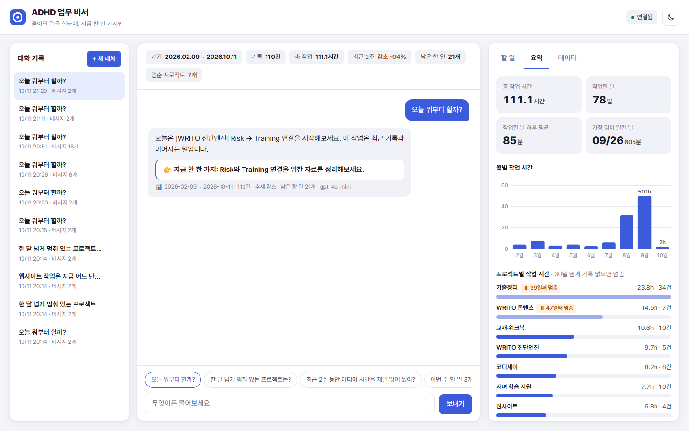
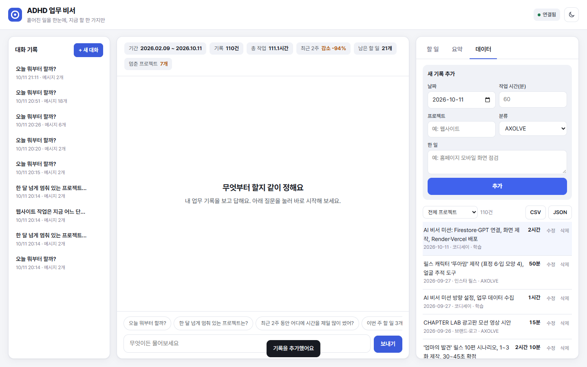
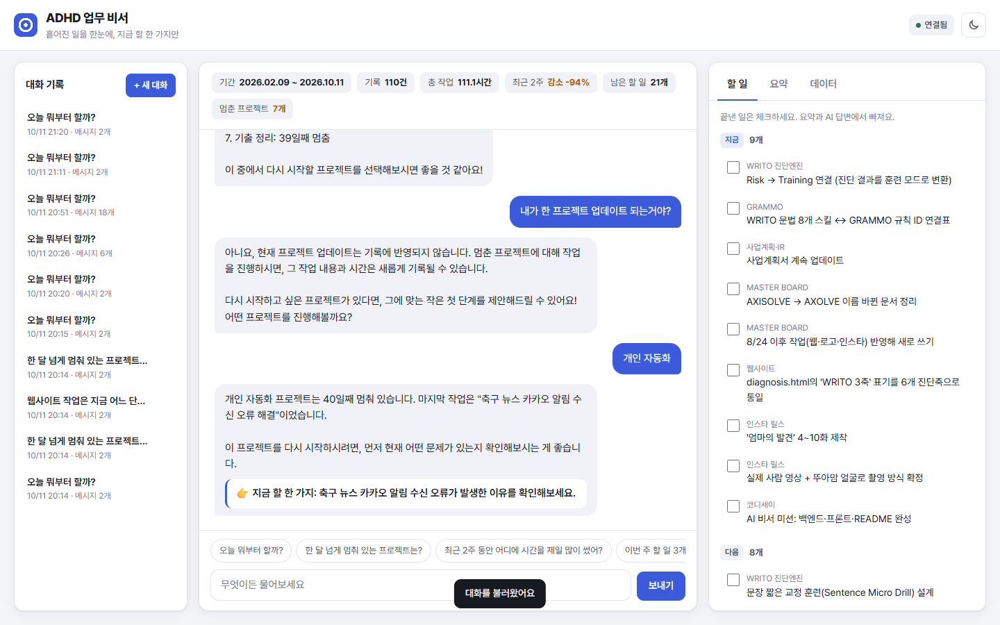
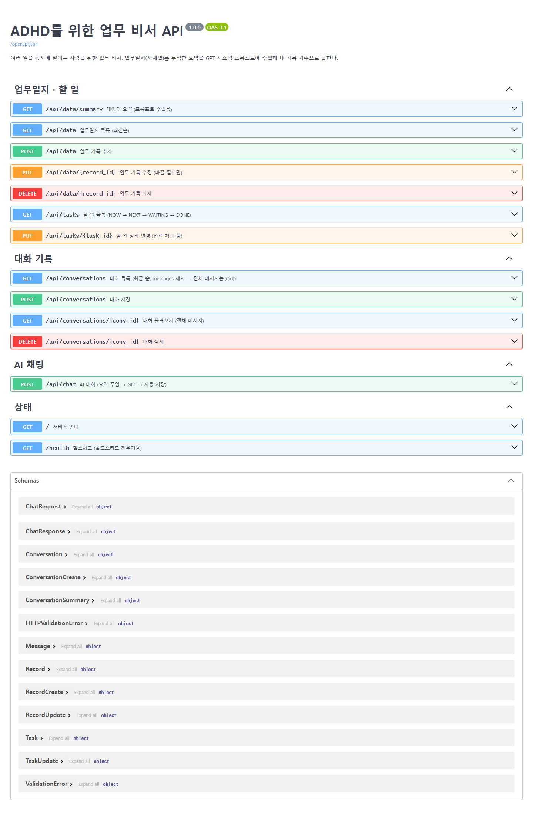
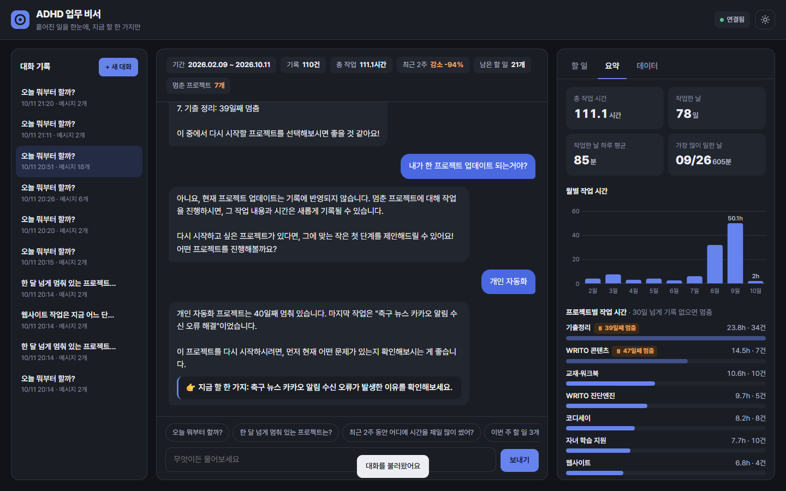
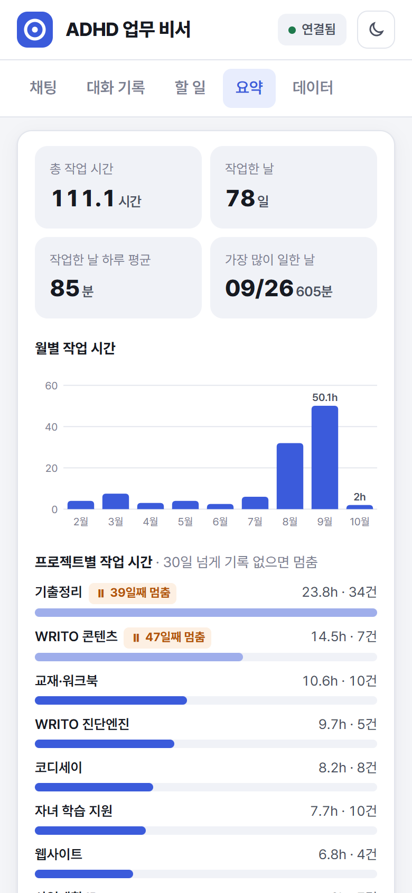

# ADHD를 위한 업무 비서

> 여러 일을 동시에 벌이는 사람을 위해, 지금까지 한 일과 남은 일을 알고 **"지금 할 한 가지"**를 알려주는 AI 비서
> 코디세이 미션 「내 상황을 아는 AI 비서」 제출물

API 키와 서비스 계정 키는 환경 변수로만 관리하고 저장소에 올리지 않습니다.

📑 만든 순서와 이유, 예상 질문은 [발표 보고서](docs/발표보고서.md)에 정리했다.

---

## 1. 서비스 소개

나는 AXOLVE(영어 라이팅 교육)를 운영하면서 WRITO 진단엔진, GRAMMO, 웹사이트, 사업계획, 인스타 자료·릴스, 기출정리, 교재 제작을 동시에 진행한다.
7개월 동안의 기록을 모아 보니 **109건의 작업이 20개 프로젝트에 흩어져 있었다.**
일이 여러 폴더와 대화에 나뉘어 있어서 "웹사이트는 어디까지 했지?", "멈춰 있는 일은 뭐지?", "그래서 지금 뭐부터 하지?"에 바로 답하기 어렵다.

이 비서는 **업무일지(시계열 데이터)**를 분석한 요약을 GPT 시스템 프롬프트에 넣어서(컨텍스트 주입), 일반론이 아니라 **내 기록**을 근거로 답한다.

| ADHD에게 어려운 점 | 비서가 하는 일 |
|---|---|
| 일이 흩어져 전체가 안 보인다 | 프로젝트별 시간·마지막 작업을 한 번에 요약 |
| 시작한 일을 잊는다 | 30일 넘게 손대지 않은 프로젝트를 "멈춤"으로 표시 |
| 무엇부터 할지 못 정한다 | 할 일은 최대 3개, 끝에 **👉 지금 할 한 가지** 하나만 제안 |
| 멈춘 일에 죄책감이 든다 | 탓하지 않고 다시 시작할 가장 작은 단계를 제안 |

예시 질문
- 오늘 뭐부터 할까?
- 웹사이트 작업은 지금 어느 단계야?
- 최근 2주 동안 어디에 시간을 제일 많이 썼어?
- 한 달 넘게 멈춰 있는 프로젝트는?

## 2. 배포 URL

| 구분 | URL |
|---|---|
| 프론트엔드 (Vercel) | https://adhd-biseo-frontend.vercel.app |
| 백엔드 API (Render) | https://adhd-biseo-api.onrender.com |
| Swagger UI | https://adhd-biseo-api.onrender.com/docs |
| 헬스체크 | https://adhd-biseo-api.onrender.com/health |

> ⏳ **처음 접속이 느린 이유** — Render 무료 서버는 15분 동안 요청이 없으면 잠들고, 다시 깨어나는 데 **최대 1분**이 걸린다.
> 화면은 열리자마자 `/health`로 서버를 깨우고, 늦어지면 상단에 *"무료 서버를 깨우는 중이에요 · N초"* 안내를 띄운다. 연결되면 오른쪽 위가 **● 연결됨**으로 바뀐다.

## 3. 기술 스택

| 영역 | 사용 |
|---|---|
| 백엔드 | Python 3.12, FastAPI, Uvicorn, Pydantic v2 |
| DB | Firebase Firestore (`firebase-admin`) |
| AI | OpenAI GPT (`openai`, 기본 `gpt-4o-mini`, 답변 최대 500토큰) |
| 설정 | python-dotenv (로컬 `.env`), Render·Vercel 환경 변수 |
| 프론트엔드 | HTML / CSS / JavaScript (프레임워크 없음) |
| 배포 | Render (백엔드), Vercel (프론트엔드) |
| 테스트 | pytest, FastAPI TestClient |

## 4. 폴더 구성

```
AXOLVE_AI_BISEO/
├─ data/                     업무일지 109행 · 할 일 22개 · 분석 요약
├─ tools/
│  ├─ build_worklog.py       업무일지·할 일 목록 생성
│  └─ analyze.py             요약 분석 (백엔드와 같은 코드 사용)
├─ docs/
│  ├─ 데이터_작성기준.md      데이터 출처와 작업 시간 계산 방법
│  └─ 발표보고서.md           진행 순서·이유·예상 질문
├─ backend/
│  ├─ main.py                앱 생성, CORS, 라우터 연결, 오류 처리
│  ├─ app/
│  │  ├─ config.py           환경 변수
│  │  ├─ schemas.py          Pydantic 요청·응답 모델 (입력 검증)
│  │  ├─ db.py               저장소 (Firestore / 로컬 JSON)
│  │  ├─ routers/            URL만 담당: data · conversations · chat
│  │  └─ services/           실제 처리: records · summary · conversations · ai
│  ├─ scripts/seed.py        data/ 파일을 Firestore에 넣기
│  └─ tests/test_api.py      API 테스트 12개
├─ render.yaml               Render 배포 설정 (Blueprint)
├─ frontend/
│  ├─ index.html             3단 화면: 대화 기록 · 채팅 · 할 일/요약/데이터 (모바일은 탭)
│  ├─ styles.css             라이트·다크 테마
│  ├─ app.js                 API 호출, 콜드스타트 안내, 그래프(SVG), CSV/JSON 내보내기
│  ├─ config.js              API 주소 (로컬 기본값)
│  ├─ build-config.js        Vercel 빌드 때 API_BASE_URL → config.js
│  └─ vercel.json
└─ screenshots/              제출 스크린샷
```

**라우터와 서비스를 나눈 기준**: 라우터는 URL·상태 코드·오류 응답만 맡고, 계산·저장·GPT 호출은 서비스가 맡는다. 그래서 요약 계산(`services/summary.py`)을 API와 분석 스크립트(`tools/analyze.py`)가 함께 쓴다.

## 5. 데이터

| 항목 | 내용 |
|---|---|
| 기간 | 2026-02-09 ~ 2026-09-27 |
| 개수 | 109행 (작업한 날 77일) |
| value | 작업 시간(분) |
| 추가 필드 | project(20개), category(AXOLVE·교육콘텐츠·학습·개인), source(측정·추정·문서) |

자세한 기준은 [docs/데이터_작성기준.md](docs/데이터_작성기준.md)에 있다.

**Firestore 컬렉션**

| 컬렉션 | 문서 | 필드 |
|---|---|---|
| `data` | 업무 기록 1건 | date, value, memo, project, category, source |
| `tasks` | 할 일 1개 | project, task, status(NOW·NEXT·WAITING·DONE), as_of, source |
| `conversations` | 대화 1개 | title, created_at, updated_at, messages[{role, content}] |

## 6. API

| 메서드 | 경로 | 설명 |
|---|---|---|
| POST | `/api/data` | 업무 기록 추가 |
| GET | `/api/data` | 목록 (최신순, `?project=` `?start=` `?end=` 거르기) |
| PUT | `/api/data/{id}` | 수정 (바꿀 필드만) |
| DELETE | `/api/data/{id}` | 삭제 |
| GET | `/api/data/summary` | 요약 (프롬프트 주입용) |
| GET | `/api/tasks` | 할 일 목록 |
| PUT | `/api/tasks/{id}` | 할 일 상태 변경 (완료 체크) |
| POST | `/api/conversations` | 대화 저장 |
| GET | `/api/conversations` | 대화 목록 (**messages 제외**, 개수만) |
| GET | `/api/conversations/{id}` | 대화 불러오기 (전체 messages) |
| DELETE | `/api/conversations/{id}` | 대화 삭제 |
| POST | `/api/chat` | AI 대화 |
| GET | `/health` | 서버 상태 (콜드스타트 깨우기용) |

**`/api/chat` 흐름**
1. 업무일지·할 일로 요약 계산 (`/api/data/summary`와 같은 함수)
2. 요약을 시스템 프롬프트에 넣음 → [미리보기](data/prompt_preview.txt)
3. GPT 호출 (이전 대화 최대 10개 함께 전송)
4. 질문과 답을 `conversations`에 자동 저장 (새 대화면 새 문서, `conversation_id`가 있으면 이어 붙임)

**입력 검증 (Pydantic)**: 날짜 형식·미래 날짜 금지, 작업 시간 1~1440분, 메모 1~200자·공백만 금지, 분류·상태는 정해진 값만. 틀리면 422로 거절한다.

## 7. 로컬 실행

```bash
cd backend
py -3.12 -m venv .venv
.venv\Scripts\activate
pip install -r requirements.txt
copy .env.example .env          # 값 채우기 (아래 표)
python -m scripts.seed          # data/ → 저장소
uvicorn main:app --reload       # http://127.0.0.1:8000/docs
python -m pytest -q             # 테스트
```

프론트엔드 (다른 터미널)
```bash
cd frontend
py -m http.server 5500          # http://127.0.0.1:5500
```

Firebase 키를 비워 두면 `backend/.localdb/`에 JSON 파일로 저장해서 키 없이도 돌려볼 수 있다.

## 8. 환경 변수

| 이름 | 위치 | 설명 |
|---|---|---|
| `OPENAI_API_KEY` | 백엔드 | OpenAI 키 |
| `OPENAI_MODEL` | 백엔드 | 기본 `gpt-4o-mini` |
| `OPENAI_MAX_TOKENS` | 백엔드 | 답변 최대 토큰, 기본 500 (비용 제한) |
| `FIREBASE_SERVICE_ACCOUNT_JSON` | 백엔드 (배포) | 서비스 계정 키 JSON 전체 |
| `FIREBASE_CREDENTIALS_PATH` | 백엔드 (로컬) | 서비스 계정 키 파일 경로 |
| `ALLOWED_ORIGINS` | 백엔드 | CORS 허용 주소, 쉼표 구분 |
| `API_BASE_URL` | 프론트엔드 | 백엔드 주소 |

## 9. 화면 기능

| 영역 | 기능 |
|---|---|
| 채팅 | 질문 입력(Enter 전송, Shift+Enter 줄바꿈), 로딩 표시, 빠른 질문 4개, "👉 지금 할 한 가지" 강조 카드, 답변 근거(기간·건수·추세) 표시 |
| 요약 | 상단 요약 칩(기간·기록·총 작업·최근 2주·남은 할 일·멈춘 프로젝트), 숫자 타일 4개, 월별 막대 그래프, 프로젝트별 막대 + 멈춤 표시 |
| 할 일 | NOW·NEXT·WAITING·끝낸 일, 체크하면 DONE (요약·AI에서 빠짐) |
| 데이터 | 추가·수정·삭제, 프로젝트 거르기, CSV/JSON 내보내기 |
| 대화 기록 | 목록, 불러오기, 삭제, 새 대화 |
| 기타 | 다크 모드, 모바일 탭 화면, 무료 서버 깨우는 중 안내(경과 초 표시) |

## 10. 스크린샷 (배포 화면)

**① 데이터 요약이 보이는 채팅 화면** — 위쪽 요약 칩(기간·기록·총 작업·추세·남은 할 일·멈춘 프로젝트), 질문 + 답변, 답변 아래 근거(기간·건수·추세·모델), 오른쪽 요약 그래프


**② 데이터 관리 화면 (추가)** — 오늘 한 일을 추가하면 목록 맨 위에 강조되어 나타나고 "기록을 추가했어요" 알림, 요약 숫자(110건·111.1시간)도 바로 바뀐다


**③ 대화 기록 화면 (불러오기)** — 왼쪽 목록에서 이전 대화를 누르면 메시지가 다시 표시되고 "대화를 불러왔어요" 알림


<details>
<summary>추가 화면: Swagger · 다크 모드 · 모바일</summary>





</details>
