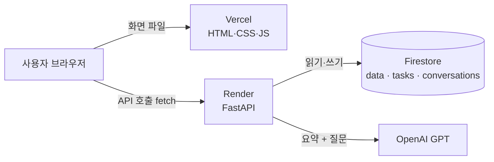
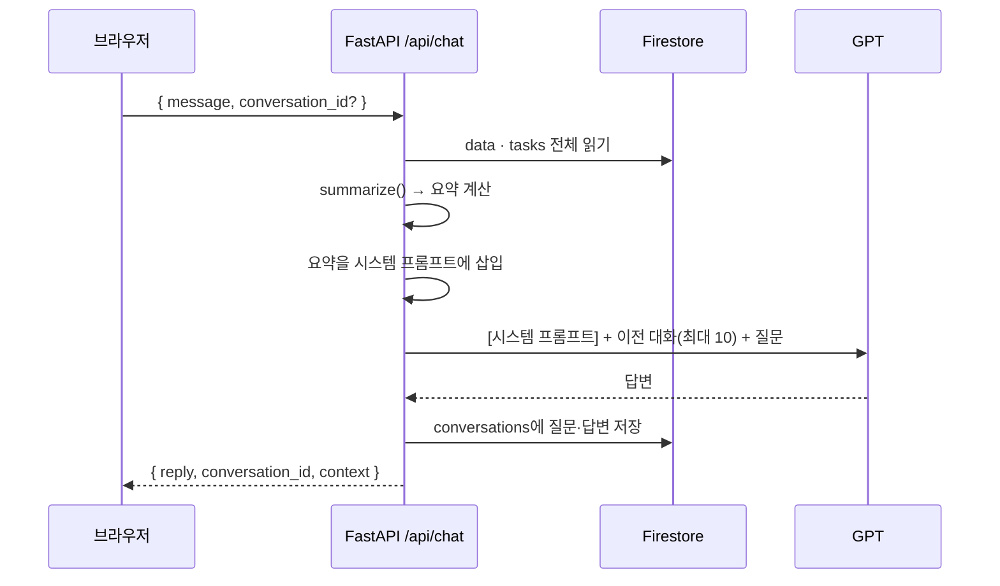

# ADHD를 위한 업무 비서 — 프로젝트 발표 보고서

> 코디세이 미션 「내 상황을 아는 AI 비서」
> 저장소 https://github.com/luvtaehee-prog/adhd-biseo · 서비스 https://adhd-biseo-frontend.vercel.app · API 문서 https://adhd-biseo-api.onrender.com/docs

이 보고서는 **무엇을 어떤 순서로 만들었는지**와 **각 단계가 왜 필요했는지**를 정리한다.
각 단계는 같은 틀로 쓴다.

> **무엇을** — 한 일 · **왜** — 이 단계가 필요한 이유 · **어떻게** — 코드와 주석 · **확인** — 동작을 증명한 방법 · **겪은 문제**

---

## 목차
0. [한 장 요약](#0-한-장-요약)
1. [미션 요구사항 ↔ 구현 대응표](#1-미션-요구사항--구현-대응표)
2. [전체 구조 한눈에 보기](#2-전체-구조-한눈에-보기)
3. [진행 순서 (10단계)](#3-진행-순서-10단계)
4. [예상 질문과 답변](#4-예상-질문과-답변)
5. [한계와 다음 계획](#5-한계와-다음-계획)
6. [용어 풀이](#6-용어-풀이)

---

## 0. 한 장 요약

| 항목 | 내용 |
|---|---|
| **문제** | 나는 AXOLVE(영어 라이팅 교육)를 운영하며 교재·웹사이트·인스타·기출 정리 등을 동시에 한다. 7개월 기록을 모아 보니 **109건의 작업이 20개 프로젝트에 흩어져** 있었다. 일반 ChatGPT는 이 사정을 모르니 "뭐부터 할까?"에 일반론만 답한다. |
| **해결** | 업무일지(시계열 데이터)를 분석한 **요약을 GPT 시스템 프롬프트에 넣어**(컨텍스트 주입), 내 기록을 근거로 답하게 했다. |
| **ADHD 관점** | 할 일은 최대 3개만, 끝에 **"👉 지금 할 한 가지"** 하나만 제안. 30일 넘게 멈춘 프로젝트를 표시하되 탓하지 않고 다시 시작할 작은 단계를 제안. |
| **기술** | FastAPI · Pydantic · Firebase Firestore · OpenAI GPT · HTML/CSS/JS(프레임워크 없음) · Render · Vercel |
| **결과** | 미션 필수 기능 4개 모두 배포 환경에서 동작 확인. 보너스(그래프·내보내기·다크 모드·추가 지표) 구현. 자동 테스트 12개 통과. |

---

## 1. 미션 요구사항 ↔ 구현 대응표

> 발표 때 "이 요구사항은 어디에 있나요?"라는 질문에 바로 답하기 위한 표.

### 1-1. 최종 결과물 4가지

| 요구사항 | 구현 | 파일 |
|---|---|---|
| 데이터 기반 AI 채팅 (+ 로딩 표시) | `POST /api/chat` — 요약 조회 → 프롬프트 주입 → GPT → 자동 저장. 화면은 점 3개 로딩 애니메이션 | `backend/app/routers/chat.py`, `frontend/app.js` `sendChat()` |
| 데이터 관리 CRUD | `POST/GET/PUT/DELETE /api/data` + 화면의 추가·수정·삭제 | `routers/data.py`, `services/records.py`, `app.js` `saveRecord()` |
| 대화 기록 저장·불러오기 | `POST/GET/DELETE /api/conversations`, `GET /api/conversations/{id}` | `routers/conversations.py`, `app.js` `openConversation()` |
| 배포·문서화 | Render(백엔드)·Vercel(프론트), Swagger `/docs`, README | `render.yaml`, `frontend/vercel.json`, `README.md` |

### 1-2. 기능 요구사항 세부

| 요구사항 | 상태 | 근거 |
|---|---|---|
| Python 3.10+ / venv | ✅ | Python 3.12, `backend/.venv` |
| 패키지 fastapi·uvicorn·firebase-admin·openai·python-dotenv | ✅ | `backend/requirements.txt` |
| 시계열 데이터 100개 이상 | ✅ | 업무일지 109행 (+배포 후 1건 추가 = 110건) |
| 요약 정보 (기간·개수·통계·추세) | ✅ | `services/summary.py` `summarize()` |
| CORS 설정 | ✅ | `main.py` `CORSMiddleware`, `ALLOWED_ORIGINS` |
| 로컬 실행·Swagger | ✅ | `uvicorn main:app --reload` → `/docs` |
| Firestore, 키는 환경 변수 | ✅ | `app/db.py`, `app/config.py` |
| 컬렉션 `data`·`conversations` | ✅ | + 할 일용 `tasks` 추가 |
| 데이터 API 5개 (CRUD 4 + summary) | ✅ | `routers/data.py` |
| 대화 API 3개 + 불러오기 (A 또는 B) | ✅ **A 방식** | `GET /api/conversations/{id}` |
| `/api/chat` 4단계 흐름 | ✅ | `routers/chat.py` 주석 1)~4) |
| Render 배포 + 콜드스타트 대응 | ✅ | `/health` 깨우기 + "서버 깨우는 중 N초" 배너 |
| 바닐라 프론트 (채팅·데이터·대화기록·요약) | ✅ | `frontend/` |
| Vercel + 환경 변수로 API 주소 | ✅ | `build-config.js` 가 `API_BASE_URL` → `config.js` |
| README (소개·스택·URL·실행·환경 변수·스크린샷) | ✅ | `README.md` §1~10 |
| 입력 검증·예외 처리 | ✅ | Pydantic 422, 404, GPT 실패 503, 그 외 500 |
| 비용 제한 (max_tokens) | ✅ | 답변 최대 500토큰, 이전 대화 최대 10개 |

### 1-3. 보너스

| 보너스 | 상태 | 내용 |
|---|---|---|
| 추가 지표 1개 이상 | ✅ | 멈춘 프로젝트(30일), 작업한 날 하루 평균, 가장 많이 일한 날, 분류별·월별 시간, 남은 할 일 |
| 그래프 1개 | ✅ | 월별 작업 시간 막대(SVG 직접 그림) + 프로젝트별 가로 막대 |
| CSV/JSON 내보내기 | ✅ | 데이터 탭 버튼 |
| 다크 모드 | ✅ | 오른쪽 위 토글, 선택 저장 |
| Function Calling + MCP/GPT Actions | ❌ 미구현 | §5 다음 계획 |

---

## 2. 전체 구조 한눈에 보기

### 2-1. 시스템 구성



- **왜 이렇게 나눴나**: 화면(프론트)과 데이터·AI 처리(백엔드)를 분리하면, 키 같은 비밀은 백엔드에만 두고 브라우저에는 절대 내려가지 않는다. 미션도 프론트는 Vercel, 백엔드는 Render로 고정했다.

### 2-2. 채팅 한 번이 처리되는 순서 (컨텍스트 주입)



### 2-3. 폴더 구조와 역할

```
adhd-biseo/
├─ data/          ① 업무일지·할 일 원본 (CSV/JSON) + 분석 결과
├─ tools/         ② 데이터 생성·분석 스크립트
├─ backend/       ③ FastAPI
│  ├─ main.py         앱 생성 · CORS · 라우터 연결 · 오류 처리
│  └─ app/
│     ├─ config.py    환경 변수 읽기
│     ├─ schemas.py   Pydantic 모델 (입력 검증)
│     ├─ db.py        저장소 (Firestore / 로컬 JSON)
│     ├─ routers/     URL 담당: data · conversations · chat
│     └─ services/    실제 처리: records · summary · conversations · ai
├─ frontend/      ④ 화면 (Vercel)
├─ docs/          데이터 작성 기준 · 이 보고서
├─ screenshots/   제출 스크린샷
└─ render.yaml    ⑤ Render 배포 설정
```

---

## 3. 진행 순서 (10단계)

| 단계 | 내용 | 미션 학습 목표 |
|---|---|---|
| 1 | 주제 정하기 · 데이터 설계 | 시계열 데이터 선정 |
| 2 | 데이터 수집 · 민감 정보 정리 | — |
| 3 | 시계열 분석 · 요약 만들기 | **목표 1** 분석 → 요약 흐름 |
| 4 | FastAPI 구조 설계 | **목표 2** 라우터/서비스 분리 |
| 5 | Pydantic 입력 검증 | **목표 3** 검증 이유와 방식 |
| 6 | Firestore 연동 · CRUD | **목표 4** Firestore CRUD |
| 7 | AI 채팅 · 컨텍스트 주입 | **목표 5** 컨텍스트 주입 원리 |
| 8 | 화면 만들기 (바닐라 JS) | — |
| 9 | 배포 (Render · Vercel) | **목표 6** CORS·환경 변수·키 관리 |
| 10 | 테스트 · 보안 점검 · 문서화 | — |

---

### 1단계. 주제 정하기 · 데이터 설계

**무엇을** — "AXOLVE 업무를 아는 비서"로 주제를 정하고, 데이터 한 행의 모양을 정했다.

**왜** — 미션의 데이터 형식은 `(date, value, memo)`이고 100개 이상이어야 한다. 그런데 "할 일 목록"은 날짜도 숫자도 없어서 시계열이 될 수 없다. 그래서 **"하루에 한 프로젝트에 쓴 작업 1건 = 1행"인 업무일지**로 바꿨다.

**어떻게** — 한 행의 필드

| 필드 | 의미 | 왜 이 필드인가 |
|---|---|---|
| `date` | 작업 날짜 | 시계열의 시간축 |
| `value` | **작업 시간(분)** | 숫자여야 평균·최대·추세 계산이 의미 있다. "완료 개수"보다 시간이 일의 크기를 더 잘 보여준다 |
| `memo` | 한 일 | AI가 "무엇을 했는지" 말할 수 있는 근거 |
| `project` | 프로젝트 이름 (추가) | "웹사이트는 어디까지?" 같은 질문에 답하려면 묶음이 필요 |
| `category` | AXOLVE·교육콘텐츠·학습·개인 (추가) | 일과 개인 일을 나눠 보기 위해 |
| `source` | 측정·추정·문서 (추가) | 값이 어떻게 나왔는지 정직하게 표시 |

여기에 **할 일 목록(`tasks`)** 을 따로 두었다. 업무일지는 "한 일"이고 할 일은 "할 일"이라 성격이 다르기 때문이다. 시계열 통계에 할 일이 섞이면 평균이 틀어진다.

---

### 2단계. 데이터 수집 · 민감 정보 정리

**무엇을** — 이미 남아 있는 기록에서 업무일지 109행과 할 일 22개를 만들었다.

**왜** — 지어낸 데이터로는 "내 상황을 아는" 비서가 될 수 없다. 실제로 이전 시도(9월 초)는 160행 중 138행이 임의로 만든 값이어서 버리고 새로 만들었다.

**어떻게** — 출처 3가지, 그리고 출처를 `source` 필드에 남겼다.

| source | 출처 | 계산 방법 | 행 |
|---|---|---|---|
| 측정 | AI 도구 작업 대화 기록 (9월) | 대화·작업 사이 간격을 더함. 20분 넘게 비면 쉰 것으로 보고 뺌 | 44 |
| 추정 | 폴더의 파일 수정 날짜 (2~9월) | 그날 바뀐 파일 수로 추정 (1~2개 30분 · 3~10개 60분 · 11~50개 120분 · 51개+ 180분) | 61 |
| 문서 | MASTER BOARD 보고서 변경 기록 (8/24) | 보고서에 적힌 작업 | 4 |

할 일은 MASTER BOARD(8/24 기준 NOW/NEXT/WAITING) + 그 뒤 작업에서 생긴 할 일로 만들었다.

**민감 정보 정리** — 저장소를 공개로 올리기 때문에 아래는 **데이터에서 삭제**했다.
- 외부에 공개하면 안 되는 사업 자료·사업 판단 내용
- 사람 이름·연락처·학생 이름
- 같은 PC를 쓰는 다른 사람의 작업 기록

> **왜 중요한가**: 데이터는 Firestore(구글 클라우드)에 저장되고, 요약은 OpenAI로 전송된다. 미션 구조상 피할 수 없으므로 **보내기 전에 데이터 자체를 정리**하는 것이 유일한 방어다.

**파일** — `tools/build_worklog.py`(생성), `data/worklog.csv`, `data/backlog.csv`, `docs/데이터_작성기준.md`

---

### 3단계. 시계열 분석 · 요약 만들기 (학습 목표 1)

**무엇을** — 109개의 행을 AI가 읽기 좋은 **짧은 요약**으로 줄였다.

**왜** — 109행을 통째로 GPT에 보내면 토큰(=비용)이 많이 들고, AI가 직접 합계를 내다 틀릴 수 있다. **계산은 코드가 정확하게 하고, AI는 결과만 읽고 말하게** 하는 것이 핵심이다.

**어떻게** — 요약에 넣은 항목과 이유

| 항목 | 예시 값 | 왜 넣었나 |
|---|---|---|
| 기간·개수 | 2026-02-09 ~ 2026-10-11, 110건 | 미션 필수. "데이터가 얼마나 되나" |
| 기본 통계 | 총 111.1시간, 기록당 평균, 중앙값, 최대·최소 | 미션 필수 |
| 최근 추세 | 최근 14일 vs 그 전 14일, ±% | 미션 필수. "요즘 일이 늘었나" |
| 프로젝트별 시간·마지막 작업 | 기출정리 23.8h, 마지막 9/2 | "웹사이트 어디까지?"에 답하는 근거 |
| **멈춘 프로젝트** | 30일 넘게 기록 없음 7개 | ADHD 관점 핵심 지표 (보너스 추가 지표) |
| 최근 기록 10건 | 날짜·프로젝트·메모 | "최근에 뭐 했지?" |
| 남은 할 일 | NOW/NEXT/WAITING | "오늘 뭐부터?" |

추세 계산 코드 (주석 = 설명)

```python
TREND_DAYS = 14                      # 최근 2주와 그 전 2주를 비교한다

def _trend(rows, today):
    # 최근 14일 동안의 작업 시간 합
    cur = sum(r["value"] for r in rows if today - timedelta(TREND_DAYS) < r["_d"] <= today)
    # 그 전 14일 동안의 작업 시간 합
    prev = sum(r["value"] for r in rows
               if today - timedelta(TREND_DAYS * 2) < r["_d"] <= today - timedelta(TREND_DAYS))
    if prev == 0:                    # 비교 대상이 0이면 % 계산 불가 → 0으로 나누기 방지
        return {"label": "증가" if cur else "유지", ..., "change_pct": None}
    pct = round((cur - prev) / prev * 100)
    # ±10% 안쪽은 "유지"로 본다 (작은 흔들림을 추세로 오해하지 않게)
    label = "증가" if pct >= 10 else "감소" if pct <= -10 else "유지"
```

**왜 "오늘" 기준인가** — `today = date.today()`. 마지막 기록 날짜가 아니라 실제 오늘을 기준으로 해야 "최근 2주 동안 기록이 없다"는 사실도 드러난다. 화면에서는 이 경우 `-100%` 대신 **"기록 없음"** 으로 보여준다(탓하는 숫자를 피하기 위해).

**같은 코드를 두 곳에서 쓴다** — `tools/analyze.py`(분석 스크립트)와 API(`GET /api/data/summary`)가 **같은 `summarize()` 함수**를 쓴다. 분석 결과와 서비스 결과가 다를 일이 없다.

**확인** — `py tools/analyze.py` 실행 결과를 `data/summary.json`, AI가 실제로 받는 글은 `data/prompt_preview.txt`에 저장해 두었다.

---

### 4단계. FastAPI 구조 설계 (학습 목표 2)

**무엇을** — 코드를 **라우터(routers) · 서비스(services) · 저장소(db) · 스키마(schemas)** 로 나눴다.

**왜** — 한 파일에 다 넣으면 "URL 처리", "계산", "DB 저장"이 뒤섞여 고치기 어렵다. 역할을 나누면
- 요약 계산(`summary.py`)을 API와 분석 스크립트가 **함께 쓸 수 있고**,
- DB를 바꿔도(Firestore ↔ 로컬 JSON) **라우터는 고칠 필요가 없고**,
- 테스트 때 GPT 부분만 **가짜로 바꿔 끼울 수** 있다.

| 층 | 하는 일 | 하지 않는 일 |
|---|---|---|
| `routers/` | URL, 상태 코드(201·204·404·503), 오류 응답 | 계산·저장 |
| `services/` | 요약 계산, 대화 저장, GPT 호출 | HTTP 상태 코드 |
| `db.py` | 컬렉션 읽기·쓰기 | 비즈니스 규칙 |
| `schemas.py` | 들어오고 나가는 데이터 모양·검증 | 처리 |

라우터 예시 (주석 = 설명)

```python
# /summary 는 /{record_id} 보다 먼저 선언해야 한다.
# 순서가 바뀌면 "summary"라는 글자를 기록 id로 착각해 404가 난다.
@router.get("/data/summary")
def get_summary():
    return svc.build_summary()          # 라우터는 서비스를 부르기만 한다

@router.put("/data/{record_id}", response_model=Record)
def update_data(record_id: str, body: RecordUpdate):   # body는 Pydantic이 이미 검증함
    doc = svc.update_record(record_id, body)
    if not doc:
        raise HTTPException(404, "기록을 찾을 수 없습니다")   # 없는 id → 404
    return doc
```

`main.py`의 공통 처리

```python
app.add_middleware(CORSMiddleware, allow_origins=config.ALLOWED_ORIGINS, ...)  # 허용한 주소만 호출 가능

@app.exception_handler(Exception)
async def unhandled(request, exc):
    # 예상 못 한 오류의 내용(키·파일 경로 등)이 사용자에게 보이지 않게 500으로 감춘다
    return JSONResponse(status_code=500, content={"detail": "서버 오류가 발생했습니다"})

@app.get("/health")                     # Render 슬립 깨우기 + 배포 버전·키 형식 점검용
```

---

### 5단계. Pydantic 입력 검증 (학습 목표 3)

**무엇을** — 요청 데이터의 모양과 범위를 `schemas.py`에 선언했다.

**왜** — 잘못된 값이 DB에 들어가면 요약이 틀어지고, 그 틀린 요약을 AI가 사실처럼 말한다. **입구에서 막는 것이 가장 싸다.** Pydantic을 쓰면 규칙을 선언만 해도 FastAPI가 자동으로 검사하고, 틀리면 **422 오류와 이유**를 돌려준다. Swagger 문서도 이 모델에서 자동으로 만들어진다.

```python
class RecordCreate(BaseModel):
    date: Date                                    # "2026-13-40" 같은 날짜는 자동 거절
    value: int = Field(ge=1, le=1440)             # 1분~1440분(하루) 밖은 거절
    memo: str = Field(min_length=1, max_length=200)
    project: str = Field(default="기타", max_length=30)
    category: Literal["AXOLVE", "교육콘텐츠", "학습", "개인"] = "AXOLVE"   # 정해진 값만

    @field_validator("date")
    def not_future(cls, v):                       # 미래 날짜 금지 (아직 안 한 일은 기록 아님)
        if v > Date.today():
            raise ValueError("미래 날짜는 기록할 수 없습니다")
        return v

    @field_validator("memo", "project")
    def strip_text(cls, v):                       # "   "처럼 공백만 있는 값 금지
        ...

class RecordUpdate(BaseModel):                    # 수정은 바꿀 필드만 보낸다 → 전부 Optional
    value: Optional[int] = Field(default=None, ge=1, le=1440)
    ...
```

**확인** — 테스트 `test_data_validation`이 6가지 잘못된 입력(0분, 2000분, 공백 메모, 없는 날짜, 미래 날짜, 없는 분류)이 모두 422인지 검사한다. 화면에서는 오류를 한국어로 바꿔 보여준다(예: "작업 시간 (1440 이하로 입력)").

---

### 6단계. Firestore 연동 · CRUD (학습 목표 4)

**무엇을** — Firebase 프로젝트 `adhdbiseo`를 만들고, 컬렉션 3개에 데이터를 넣고, CRUD를 연결했다.

**왜 Firestore** — 미션 지정. 서버(Render 무료)는 재시작하면 파일이 지워지므로 데이터는 **바깥 DB**에 있어야 한다.

| 컬렉션 | 문서 하나 | 필드 |
|---|---|---|
| `data` | 업무 기록 1건 | date, value, memo, project, category, source |
| `tasks` | 할 일 1개 | project, task, status, as_of, source |
| `conversations` | 대화 1개 | title, created_at, updated_at, messages[{role, content}] |

**대화를 문서 하나에 messages 배열로 담은 이유** — "대화 불러오기"는 항상 대화 전체를 한 번에 읽는다. 메시지를 따로 저장하면 여러 번 읽어야 한다. 대화 하나가 Firestore 문서 한도(1MB)를 넘을 일은 없다.

**키 관리**

```python
# config.py — 키는 코드에 쓰지 않고 환경 변수에서만 읽는다
FIREBASE_SERVICE_ACCOUNT_JSON = os.getenv("FIREBASE_SERVICE_ACCOUNT_JSON", "").strip()  # 배포: 키 내용 전체
FIREBASE_CREDENTIALS_PATH     = os.getenv("FIREBASE_CREDENTIALS_PATH", "").strip()      # 로컬: 키 파일 경로
```
- 로컬: 키 파일을 **프로젝트 폴더 밖**(`C:\Users\…\keys\`)에 두고 `.env`에 경로만 적었다 → 실수로 GitHub에 올릴 수 없다.
- 배포: Render 환경 변수에 키 내용을 넣었다.

**저장소를 두 가지로 만든 이유 (`db.py`)**

```python
def get_store():
    if 키가 있으면:  return FirestoreStore()     # 실제 서비스
    else:            return JsonStore(".localdb") # 키 없이 개발·테스트할 때
```
Firebase 키를 받기 전에도 개발을 진행할 수 있었고, 자동 테스트는 매번 **임시 폴더의 JsonStore**를 써서 실제 DB를 더럽히지 않는다. 두 저장소는 같은 함수(list·get·create·update·delete)를 갖고 있어 위쪽 코드는 차이를 모른다.

**데이터 넣기** — `python -m scripts.seed`: `worklog.json`·`backlog.csv`를 같은 id(w001, t01…)로 넣는다. 같은 id로 덮어쓰므로 여러 번 실행해도 중복되지 않는다.

**확인** — 실제 Firestore에서 추가 → 수정 → 삭제를 돌려 개수가 109 → 110 → 109로 바뀌는 것을 확인했다.

---

### 7단계. AI 채팅 · 컨텍스트 주입 (학습 목표 5)

**무엇을** — `POST /api/chat`. 미션이 정한 4단계를 그대로 구현했다.

**왜 "컨텍스트 주입"인가** — GPT는 내 데이터를 학습한 적이 없다. 그래서 질문할 때마다 **시스템 프롬프트에 내 상황 요약을 붙여서** 보낸다. 모델을 새로 학습시키는 것(파인튜닝)보다 싸고, 데이터가 바뀌면 다음 질문부터 바로 반영된다.

```python
@router.post("/chat")
def chat(body: ChatRequest):
    history = []
    if body.conversation_id:                          # 이어지는 대화면 이전 메시지를 가져온다
        history = conversations.get_conversation(body.conversation_id)["messages"]

    summary = records.build_summary()                 # 1) 데이터 요약 조회 (/api/data/summary와 같은 함수)
    try:
        reply = ai.ask(summary, history, body.message)  # 2) 프롬프트에 주입  3) GPT 호출
    except ai.AIUnavailable as e:
        raise HTTPException(503, str(e))              # GPT 실패 → 503, 이때는 저장하지 않는다

    new = [{"role": "user", ...}, {"role": "assistant", ...}]
    if body.conversation_id:                          # 4) 대화 자동 저장
        conversations.append_messages(...)            #    이어지는 대화면 뒤에 붙이고
    else:
        conv_id = conversations.create_conversation(new)["id"]   # 새 대화면 새 문서
```

GPT 호출 (주석 = 설명)

```python
messages = [{"role": "system", "content": build_system_prompt(summary)}]   # 요약이 들어간 시스템 프롬프트
messages += history[-config.CHAT_HISTORY_LIMIT:]   # 이전 대화는 최근 10개만 (토큰·비용 제한)
messages.append({"role": "user", "content": message})
client.chat.completions.create(
    model=config.OPENAI_MODEL,                     # gpt-4o-mini: 싸고 빠름
    max_completion_tokens=config.OPENAI_MAX_TOKENS,  # 답변 최대 500토큰 (비용 상한)
    temperature=0.4,                               # 낮을수록 데이터에 충실, 덜 지어냄
)
```

**시스템 프롬프트 구성**

```
당신은 'ADHD를 위한 업무 비서'입니다. …
[사용자 업무 데이터 요약]        ← summary.py의 to_prompt_text()가 만든 글
[이 서비스 사용법]                ← 기록·수정·체크 방법을 물으면 안내
[답변 규칙]
1. 위 데이터의 숫자·날짜·프로젝트만 근거로. 없으면 "기록에 없어요"   ← 지어내기 방지
2. 할 일 추천은 3개 이하. 사실 목록은 빠짐없이                       ← ADHD: 선택지 줄이기
3. "뭐부터 할까"는 NOW 할 일에서 고른다
4. 마지막 줄 "👉 지금 할 한 가지" = 15분 안에 시작할 구체적 행동      ← 막연한 "계획 세우기" 금지
5. 멈춘 일을 탓하지 않는다
6. 친근한 존댓말  7. 의학적 조언 금지
```

**프롬프트를 실제 답변을 보며 고친 과정** (발표 포인트)

| 처음 답변의 문제 | 원인 | 고친 방법 |
|---|---|---|
| "오늘 뭐부터?"에 할 일 목록을 무시 | 어디서 고를지 규칙이 없었다 | 규칙 3 추가 (NOW에서 고르기) |
| "지금 할 한 가지: 간단히 계획해보세요" | 막연해도 된다고 여김 | 규칙 4에 "15분 안에 시작할 구체적 행동", "계획 세우기 금지" |
| 멈춘 프로젝트 순서·개수가 틀림 | AI가 목록에서 직접 골라냄 | 요약에 **[멈춘 프로젝트] 오래된 순** 칸을 코드로 미리 만들어 줌 |
| "내 기록이 반영돼?"에 "아니요"라고 틀리게 답함 | AI가 서비스 기능을 모름 | **[이 서비스 사용법]** 칸 추가 |

> 교훈: **AI가 틀리는 부분은 계산을 코드로 옮기거나, 알아야 할 사실을 프롬프트에 넣어서** 고친다.

**화면에서 근거 보여주기** — 응답의 `context`(기간·건수·추세·남은 할 일)를 답변 아래에 표시한다. 답이 정말 내 데이터에서 나왔는지 사용자가 확인할 수 있다.

---

### 8단계. 화면 만들기 (바닐라 HTML/CSS/JS)

**무엇을** — 프레임워크 없이 `index.html`·`styles.css`·`app.js` 3개 파일로 만들었다.

**왜 이 구성인가** — 미션이 프레임워크 사용을 금지했다. 대신 화면 하나에 4가지 필수 기능이 모두 보이게 3칸으로 배치했다.

```
┌ 대화 기록 ┬────── 채팅 ──────┬ 할 일 · 요약 · 데이터 ┐
│ 목록      │ 요약 칩           │ (탭 전환)              │
│ 불러오기  │ 말풍선 + 로딩      │ 그래프 · CRUD · 내보내기│
└──────────┴─────────────────┴───────────────────────┘
   휴대폰 폭에서는 위쪽 탭(채팅·대화 기록·할 일·요약·데이터)으로 바뀐다
```

| 기능 | 구현 포인트 | 왜 |
|---|---|---|
| API 주소 | `config.js`의 `API_BASE_URL` (Vercel 빌드 때 환경 변수로 생성) | 주소를 코드에 박지 않아야 로컬·배포를 오갈 수 있다 |
| 콜드스타트 | 열리자마자 `/health` 호출, 2.5초 넘으면 "서버 깨우는 중 · N초" 배너 | Render 무료 서버는 깨는 데 최대 1분. 멈춘 것처럼 보이면 사용자가 떠난다 |
| 로딩 표시 | 질문 즉시 내 말풍선 + 점 3개 | 미션 필수. GPT 답변은 몇 초 걸린다 |
| "👉 지금 할 한 가지" | 그 줄만 강조 카드로 분리 | ADHD: 가장 중요한 한 줄이 눈에 띄게 |
| 한글 Enter | `e.isComposing`일 때 Enter 무시 | 한글 조합 중 Enter로 마지막 글자가 두 번 전송되는 문제 방지 |
| 보안 | 답변은 `textContent`로만 넣음 (`innerHTML` 안 씀) | AI 답변이나 메모에 HTML이 섞여도 실행되지 않게 (XSS 방지) |
| 그래프 | SVG를 직접 그림 + 마우스 올리면 값 표시 | 라이브러리 없이. 막대 색은 밝은/어두운 배경 모두 대비 검사 통과 |
| 내보내기 | CSV(엑셀용 BOM 포함)·JSON | 보너스. 엑셀에서 한글 깨짐 방지 |
| 할 일 체크 | 체크 → `PUT /api/tasks/{id}` DONE → 요약 다시 읽기 | 끝낸 일이 AI 추천에서 빠져야 한다 |

**테스트하며 고친 버그** — 작업 시간 입력칸이 `min=1 step=5`라 **30·60을 넣으면 브라우저가 저장을 막았다**(1, 6, 11…만 허용). `step=1`로 고쳤다. 실제 브라우저로 클릭해 보는 테스트에서 발견했다.

---

### 9단계. 배포 — Render · Vercel (학습 목표 6)

**무엇을** — GitHub 공개 저장소에 올리고, 백엔드는 Render, 프론트는 Vercel에 배포했다.

**순서와 이유**

| 순서 | 한 일 | 왜 이 순서인가 |
|---|---|---|
| 1 | GitHub 저장소 `adhd-biseo` 생성·업로드 | Render·Vercel 모두 GitHub에서 코드를 가져간다 |
| 2 | Render: `render.yaml`(Blueprint)로 서비스 생성, 비밀 값 3개 입력 | 백엔드 주소가 있어야 프론트가 어디로 요청할지 정할 수 있다 |
| 3 | Vercel: Root `frontend`, 환경 변수 `API_BASE_URL` = Render 주소 | |
| 4 | Render `ALLOWED_ORIGINS`에 Vercel 주소 추가 | 프론트 주소가 생긴 뒤에야 허용 목록에 넣을 수 있다 |

**`render.yaml` 주석**

```yaml
rootDir: backend                        # 저장소 안의 backend 폴더만 서버로 실행
startCommand: uvicorn main:app --host 0.0.0.0 --port $PORT   # Render가 정해 주는 포트로 연다
healthCheckPath: /health                # Render가 서버 상태를 이 주소로 확인
envVars:
  - key: OPENAI_API_KEY
    sync: false                         # 값을 파일에 쓰지 않고 Render 화면에서 직접 입력
```

**CORS가 왜 필요한가** — 브라우저는 보안을 위해 *다른 주소*(vercel.app → onrender.com)로 요청할 때 서버의 허락을 확인한다. 서버가 `Access-Control-Allow-Origin`으로 허락하지 않으면 브라우저가 응답을 버린다. 그래서 `ALLOWED_ORIGINS`에 **Vercel 주소만** 넣었다. `*`(전부 허용)를 쓰지 않은 이유는, 다른 웹사이트가 방문자의 브라우저를 통해 내 API를 부르는 것을 막기 위해서다.

> ⚠️ **CORS의 한계**: CORS는 *브라우저*만 지키는 규칙이다. curl·파이썬처럼 브라우저가 아닌 프로그램은 CORS와 상관없이 API를 부를 수 있다. 지금 API에는 로그인이 없어서, 주소를 아는 사람은 기록을 지우거나 채팅으로 GPT 비용을 쓸 수 있다. 미션 범위 밖이라 두었고, 대비책은 ① OpenAI 월 사용 한도 ② `scripts/seed.py`로 데이터 복구 ③ 다음 계획인 접속 토큰(§5)이다.

**환경 변수 정리**

| 이름 | 어디에 | 왜 환경 변수인가 |
|---|---|---|
| `OPENAI_API_KEY` | Render | 노출되면 남이 내 돈으로 GPT를 쓴다 |
| `FIREBASE_SERVICE_ACCOUNT_JSON` | Render | 노출되면 DB 전체를 읽고 지울 수 있다 |
| `ALLOWED_ORIGINS` | Render | 배포 주소가 바뀌어도 코드 수정 없이 변경 |
| `API_BASE_URL` | Vercel | 로컬(127.0.0.1)과 배포(onrender.com) 주소가 다르다 |

**배포 중 겪은 문제와 해결** (발표 포인트)

| 증상 | 진단 | 해결 |
|---|---|---|
| 배포 서버에서만 채팅 503 `APIConnectionError` | 키 값은 숨긴 채 **형식만** 보여주는 점검을 `/health`에 추가 → PC 키 164자 / Render 키 **189자 + 중간 공백** | 키를 다시 붙여넣음. 코드에도 앞뒤 공백 제거(`.strip()`) 추가 |
| 오류 원인이 안 보임 | 예외의 원인 이름만 표시 (`APIConnectionError ← LocalProtocolError`) | 메시지 본문엔 키가 들어 있을 수 있어 **이름만** 노출 |
| 어떤 버전이 배포됐는지 모름 | `/health`에 배포 커밋 번호(`version`) 표시 | 고친 코드가 실제로 반영됐는지 확인 가능 |
| 키가 대화창에 노출됨 | — | 새 키 발급 → PC·Render 교체 → 동작 확인 → **마지막에** 예전 키 폐기 (순서를 지켜 서비스 중단 없음) |

**확인** — 배포 주소에서 Swagger 열림, Firestore 연결, 채팅 답변, CORS 허용 헤더, 화면의 추가·불러오기 동작을 모두 확인하고 그 화면으로 스크린샷을 찍었다.

---

### 10단계. 테스트 · 보안 점검 · 문서화

**자동 테스트 12개** (`backend/tests/test_api.py`) — 키·비용 없이 돌도록 임시 저장소를 쓰고 GPT는 가짜 함수로 바꿨다.

| 테스트 | 무엇을 증명하나 |
|---|---|
| `test_data_crud` | 추가 → 목록(최신순) → 수정(바꾼 필드만) → 삭제 → 다시 삭제하면 404 |
| `test_data_validation` ×6 | 잘못된 입력 6종이 모두 422 |
| `test_summary_route_not_taken_as_id` | `/data/summary`가 id로 오인되지 않음 |
| `test_tasks` | 할 일 DONE 처리 → 요약의 남은 할 일에서 빠짐 |
| `test_conversations` | 저장 → 목록(messages 제외) → 불러오기 → 삭제 |
| `test_chat_injects_summary_and_saves` | **요약이 실제로 프롬프트에 들어가는지**, 이어진 대화에 이전 메시지가 전달되는지, 4개 메시지로 저장되는지 |
| `test_chat_without_key_returns_503` | 키가 없으면 503이고 **실패한 대화는 저장되지 않음** |

**화면 테스트** — 실제 브라우저를 코드로 조작해 추가·검증 오류·삭제·대화 불러오기를 확인했다(콘솔 오류 0개, 휴대폰 폭 가로 넘침 없음).

**보안 점검**
- `.gitignore`: `.env`, 키 파일, 가상환경, 로컬 DB 제외
- GitHub에 올리기 전마다 API 키·서비스 계정 키 형식, 전화번호, 민감 단어를 검색해 **0건**인지 확인
- 서비스 계정 키는 프로젝트 폴더 밖에 보관
- 답변 토큰 상한(500), OpenAI 대시보드 월 사용 한도(Limits) 설정 권장

**문서화** — `README.md`(소개·URL·스택·구조·API·실행·환경 변수·화면·스크린샷), `docs/데이터_작성기준.md`(데이터 출처와 계산식), 이 보고서.

---

## 4. 예상 질문과 답변

### 데이터·분석
**Q1. 왜 업무 데이터를 골랐나? 주식이나 날씨가 더 쉬운데.**
A. 미션 주제가 "**내 상황을 아는** 비서"다. 공개 데이터는 누구나 같은 답을 받는다. 실제로 흩어진 내 일을 정리하는 문제가 있었고, 그게 이 서비스를 쓸 이유다.

**Q2. 작업 시간(value)이 정확한가?**
A. 아니다, 그래서 `source`로 구분했다. 9월은 작업 기록에서 **측정**(44행), 그 전은 파일 수정 날짜로 **추정**(61행), 4행은 보고서 기록이다. 계산식은 `docs/데이터_작성기준.md`에 있다. 틀린 값은 화면에서 수정할 수 있다. 정확도보다 **출처를 숨기지 않는 것**을 택했다.

**Q3. 추세는 어떻게 계산하나?**
A. 오늘 기준 최근 14일 합 vs 그 전 14일 합. ±10% 안은 "유지". 그 전 기간이 0이면 %를 계산하지 않는다(0으로 나누기 방지).

**Q4. 100개 이상인가?**
A. 업무일지 109행으로 시작했고, 배포 후 화면에서 1건을 추가해 110건이다. 할 일 22개는 별도 컬렉션이라 이 수에 넣지 않았다.

### 구조·FastAPI
**Q5. 라우터와 서비스를 왜 나눴나?** (목표 2)
A. 라우터는 URL·상태 코드만, 서비스는 계산·저장·GPT만. 덕분에 요약 함수를 API와 분석 스크립트가 같이 쓰고, 테스트에서 GPT만 가짜로 바꿀 수 있었다.

**Q6. `/api/data/summary`와 `/api/data/{id}` 순서가 왜 중요한가?**
A. FastAPI는 위에서부터 경로를 맞춘다. `{id}`가 먼저면 "summary"를 id로 보고 404를 낸다. 그래서 summary를 먼저 선언했고 테스트로 막아 두었다.

**Q7. Pydantic을 왜 썼나?** (목표 3)
A. 잘못된 값이 DB에 들어가면 요약이 틀리고, AI가 틀린 요약을 사실처럼 말한다. 규칙을 선언만 하면 FastAPI가 자동 검사해 422와 이유를 준다. Swagger 문서도 이 모델에서 만들어진다.

**Q8. 오류 응답은 어떻게 나뉘나?**
A. 입력 오류 422, 없는 id 404, GPT 실패 503, 나머지 500(내부 내용은 숨김).

### Firestore
**Q9. 컬렉션은 어떻게 설계했나?** (목표 4)
A. `data`(업무 기록), `conversations`(대화, messages 배열 포함), 그리고 할 일용 `tasks`. 대화는 항상 통째로 불러오므로 문서 하나에 담았다.

**Q10. 대화 불러오기는 A/B 중 무엇인가?**
A. **A**. 목록(`GET /api/conversations`)은 제목·시간·메시지 수만 주고, 전체 메시지는 `GET /api/conversations/{id}`로 받는다. 목록이 가벼워진다.

**Q11. 서비스 계정 키는 어떻게 관리했나?**
A. 코드에 없다. 로컬은 프로젝트 폴더 밖의 파일 경로를 `.env`에, 배포는 Render 환경 변수에 키 내용을 넣었다. `.env`와 키 파일은 `.gitignore`로 막았다.

### AI·컨텍스트 주입
**Q12. 컨텍스트 주입이 뭔가? 파인튜닝과 차이는?** (목표 5)
A. 질문할 때마다 시스템 프롬프트에 내 데이터 요약을 붙여 보내는 것. 모델을 다시 학습시키지 않으니 싸고, 데이터를 바꾸면 다음 질문부터 바로 반영된다.

**Q13. 왜 원본 109행이 아니라 요약을 넣었나?**
A. 비용(토큰)과 정확도. 합계·평균을 AI가 세면 틀릴 수 있다. 계산은 코드가 하고 AI는 결과를 말만 하게 했다. 대신 "최근 기록 10건"은 원문 그대로 넣어 구체적인 질문에도 답하게 했다.

**Q14. AI가 지어내는 건 어떻게 막았나?**
A. ① 규칙 1 "데이터에 없으면 '기록에 없어요'" ② temperature 0.4 ③ 틀리기 쉬운 계산(멈춘 프로젝트 순서 등)은 코드로 미리 계산 ④ 답변 아래 근거(기간·건수·추세)를 보여줘 사용자가 확인.

**Q15. 비용은 어떻게 통제했나?**
A. gpt-4o-mini, 답변 최대 500토큰, 이전 대화 최대 10개. CORS는 Vercel 주소만 허용했다. 다만 CORS는 브라우저만 막으므로, 비용의 최종 안전장치는 OpenAI 대시보드의 월 사용 한도다(§3-9 CORS의 한계).

### 배포·운영
**Q16. CORS가 왜 필요한가?** (목표 6)
A. 화면(vercel.app)과 서버(onrender.com)의 주소가 다르다. 브라우저는 서버가 허락한 주소의 요청만 응답을 받게 한다. 그래서 Vercel 주소만 허용 목록에 넣었다.

**Q17. 환경 변수를 왜 쓰나?**
A. ① 비밀(키)을 코드·GitHub에서 분리 ② 같은 코드를 로컬·배포에서 주소만 바꿔 실행. 키가 노출되면 남이 내 비용으로 GPT를 쓰거나 DB를 지울 수 있다.

**Q18. 첫 접속이 느린 건?**
A. Render 무료 서버는 15분 동안 요청이 없으면 잠든다. 화면이 열리자마자 `/health`로 깨우고, 늦으면 "서버 깨우는 중 · N초" 배너를 띄운다.

**Q19. 배포하며 가장 어려웠던 점은?**
A. 배포 서버에서만 채팅이 실패했다. 키 값은 숨기고 **형식(길이·공백)만** 보여주는 점검을 만들어 원인을 찾았다(붙여넣을 때 공백이 섞임). 로그를 볼 수 없는 환경에서 **안전하게 진단하는 방법**을 배웠다.

### ADHD 관점
**Q20. ADHD를 위한 기능이 구체적으로 뭔가?**
A. 할 일 추천 최대 3개, "👉 지금 할 한 가지"(15분 안에 시작할 행동) 강조 카드, 멈춘 프로젝트 표시와 탓하지 않는 문구("감소 -100%" 대신 "기록 없음"), 빠른 질문 버튼(무엇을 물을지 고민 줄이기), 할 일 체크 시 칭찬 알림. 의학적 진단·치료 조언은 하지 않도록 막았다.

---

## 5. 한계와 다음 계획

| 한계 | 이유 | 다음 계획 |
|---|---|---|
| 작업 시간 중 61행이 추정값 | 과거 기록이 파일 날짜뿐 | 앞으로는 화면에서 직접 기록 → 측정값 비율 증가 |
| 로그인이 없다 — 주소를 알면 누구나 기록 삭제·채팅 가능 | 미션 범위 밖, 1인용 | 접속 비밀번호(헤더 토큰) + 요청 횟수 제한 |
| 무료 서버 슬립 | Render 무료 요금제 | 사용자 안내로 대응 중. 필요하면 유료 전환 |
| AI가 기능을 직접 호출하지 못함 | 보너스 미구현 | **Function Calling**: `get_summary`, `list_tasks`, `search_records(project)`를 도구로 정의해 GPT가 필요할 때 부르게 하고, 같은 기능을 **MCP 서버**로 Claude 등 외부 앱에서도 호출 |
| 할 일 추가 화면이 없음 | 미션 필수 아님 | `POST /api/tasks` + 화면 입력칸 |

---

## 6. 용어 풀이

| 용어 | 쉬운 설명 |
|---|---|
| 시계열 데이터 | 날짜 순서대로 쌓인 숫자 기록 (예: 날짜별 작업 시간) |
| API | 프로그램끼리 주고받는 창구. 여기서는 화면 ↔ 서버 |
| 엔드포인트 | API의 주소 하나 (예: `POST /api/chat`) |
| CRUD | 만들기(Create)·읽기(Read)·고치기(Update)·지우기(Delete) |
| FastAPI | 파이썬으로 API 서버를 만드는 도구. Swagger 문서를 자동으로 만든다 |
| Pydantic | 데이터 모양·범위를 선언하고 자동 검사하는 도구 |
| Swagger (`/docs`) | API 목록을 보고 바로 시험해 볼 수 있는 자동 문서 화면 |
| Firestore | 구글의 클라우드 문서형 DB. 컬렉션 안에 문서가 들어간다 |
| 서비스 계정 키 | 서버가 Firestore에 관리자로 접속하는 열쇠 파일 |
| 시스템 프롬프트 | AI에게 대화 전에 주는 역할·규칙·배경 설명 |
| 컨텍스트 주입 | 시스템 프롬프트에 내 데이터 요약을 넣어 보내는 방법 |
| 토큰 | AI가 글을 세는 단위. 많을수록 비용이 든다 |
| temperature | AI 답변의 무작위성. 낮을수록 일관되고 덜 지어낸다 |
| CORS | 다른 주소에서 온 브라우저 요청을 서버가 허락하는 규칙 |
| 환경 변수 | 코드 밖에서 넣어 주는 설정값 (키·주소 등) |
| 콜드스타트 | 잠든 무료 서버가 첫 요청에 깨어나느라 느린 현상 |
| 422 / 404 / 503 | 입력 오류 / 없음 / 외부 서비스(GPT) 사용 불가 |
| XSS | 화면에 넣은 글 속 코드가 실행되는 공격. `textContent`로 막는다 |
